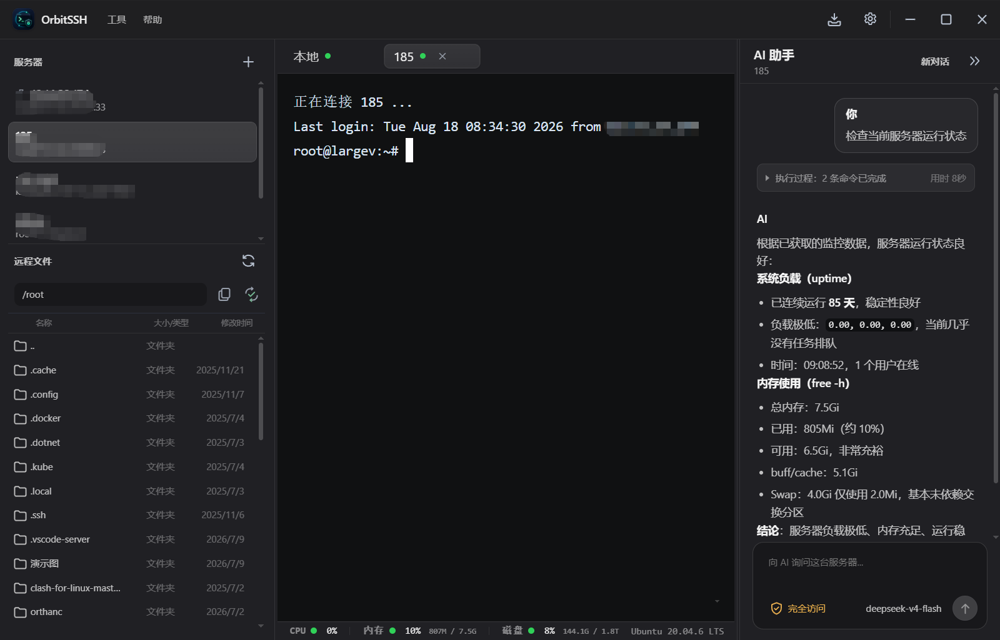
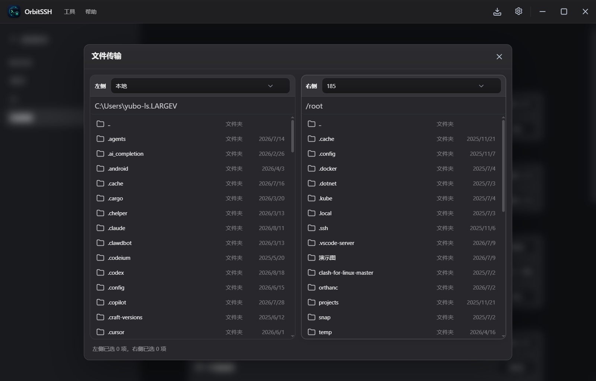
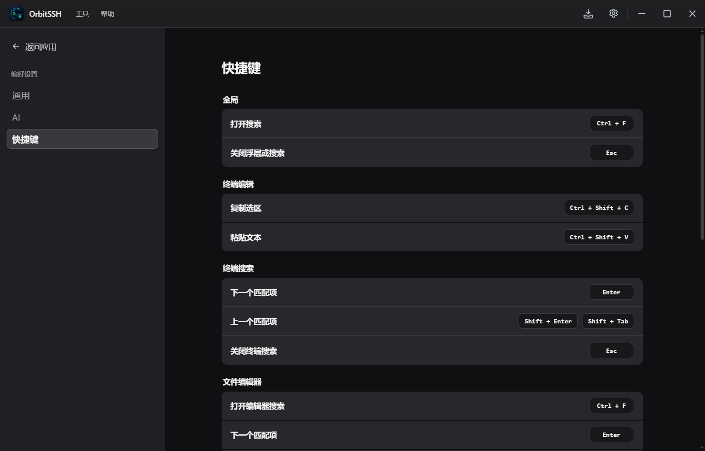

<p align="center"></p>

<h1 align="center">OrbitSSH</h1>

<p align="center"><strong>现代化 · 高性能 · 受控 AI 运维</strong></p>

<p align="center">
  
  
  
  
  
</p>

<p align="center">简体中文 | <a href="README.en.md">English</a></p>

## 概览

OrbitSSH 将 SSH 终端、SFTP 文件管理、服务器间传输、常用自动化任务和 AI 辅助诊断整合到一个桌面应用中。Electron 主进程管理 SSH、SFTP、文件和 AI 命令执行；Vue Renderer 只负责界面与交互。

仓库提供 Windows 安装包与 macOS 打包脚本。开发环境需要 Node.js 22 或更高版本。

## 界面预览

| 终端主页 | SFTP 文件传输 | 设置面板 |
| :---: | :---: | :---: |
|  |  |  |

## 功能

### SSH 终端

- 远程 SSH 与本地终端，多标签页并行会话。
- xterm.js 终端渲染、自动调整尺寸、终端搜索、选中复制和右键粘贴。
- 断线重连，以及可配置的 SSH/SFTP keepalive 与空闲断开时间。
- 校验服务器主机密钥：首次连接时确认指纹后记住，之后密钥变化会明确提示，由用户决定是否继续连接。
- 终端路径会同步给文件面板和 AI 上下文；路径未知时 AI 在登录默认目录执行。

### SFTP 与文件传输

- 本地与远程文件浏览，支持新建、重命名、删除、图片预览和远程文本文件编辑。
- 文件及文件夹上传、下载，支持拖拽、进度、暂停、继续与取消。
- 本地目录与远程目录同步，可选择要传输的差异项。
- 服务器间文件传输通过本地应用中转，不要求服务器之间互相 SSH。
- 对稳定且 SHA-256 一致的大文件可跳过重复传输；临时文件与续传逻辑降低中断影响。

### 服务器与自动化任务

- 保存密码或私钥认证的连接配置，常用服务器可置顶。
- 密码和私钥口令使用 Electron `safeStorage` 加密保存；私钥内容不写入应用配置，仅在连接时读取指定私钥文件。
- 每台服务器可保存常用脚本，通过独立 SSH 连接运行，支持实时 stdout/stderr 与手动取消。

### AI 运维助手

- 每个终端标签页维护独立 AI 会话，不混用不同服务器的上下文。
- 支持 DeepSeek、GLM 及其他 OpenAI 兼容接口。
- 支持流式回复、Markdown 渲染和命令卡片状态：等待审批、执行中、完成、失败、拒绝或取消。
- 模型只能请求在当前终端执行命令，或在用户明确点名的已保存服务器执行命令；禁止经当前服务器再次 `ssh`、`scp` 或 `sftp` 跳转。
- 三种权限模式：
  - `ask`：每条命令均需人工确认。
  - `auto`：已识别的高风险或敏感读取需确认；低中风险命令可自动执行。
  - `full_access`：当前终端内格式有效的命令直接执行，不产生审批；跨服务器命令仍需逐次批准。
- 主进程检查命令格式、复合命令、敏感数据源和高风险操作；用户批准也不能绕过格式无效的拒绝结果。
- 终端输出、工具结果和常见凭据会脱敏并限制长度。最近终端输出默认不发送给在线模型，需由用户显式开启。
- 单轮执行受命令数、总时长、重复命令和连续无进展检测约束；请求与正在运行的命令均可取消。
- 模型请求按首字节、输出间隔和总时长分别限时，限流或服务端繁忙时按 `Retry-After` 退避重试；失败时提示具体原因，例如 API Key 无效、Base URL 错误或额度不足。

### 应用行为

- 深色 / 浅色主题，以及终端字体大小、行高和选区颜色设置。
- 左侧服务器、自动化任务和远程文件面板支持排序、折叠与调整高度。
- 系统托盘、单实例启动、Windows 启动诊断，以及基于 `electron-updater` 的更新检查和下载进度。
- 应用内不会打开新窗口或跳转外部页面；http/https 链接交给系统浏览器打开，其他协议直接拦截。

## 架构

```text
Renderer：Vue 3 + Pinia
Terminal / SFTP / Automation / Settings / AI UI
                │ contextBridge IPC
Preload：按需暴露的受限 API
                │
Main Process：SSH · SFTP · 传输队列 · 自动化任务
              AI Agent · 命令策略 · 审批 · 存储 · 更新 · 日志
```

- `contextIsolation: true`、`sandbox: true`、`nodeIntegration: false`；Renderer 无法直接访问 Node.js 或 SSH 连接。
- SSH/SFTP 状态、文件读写和 AI 工具执行均由主进程校验 IPC 输入和会话归属后处理。
- AI 模型负责提出回复或结构化工具请求；本地代码负责权限决策和实际执行。

## 技术栈

| 层级 | 技术 |
| --- | --- |
| 桌面应用 | Electron 37、TypeScript |
| 界面 | Vue 3、Pinia、Vite |
| 终端 | xterm.js、Canvas addon、node-pty |
| SSH / SFTP | ssh2、ssh2-sftp-client |
| 编辑与 Markdown | CodeMirror 6、markdown-it、DOMPurify |
| 本地存储 | electron-store、Electron safeStorage |
| 打包与更新 | electron-builder、electron-updater |

## 快速开始

环境要求：Node.js 22+、npm 9+。

```bash
git clone https://gitee.com/ksdhy/orbit-ssh
cd orbitssh
npm install
npm run dev:electron
```

```bash
# Vue 类型检查、构建 Renderer、编译 Electron 主进程并同步 Preload
npm run build

# 提交前完整检查：格式、ESLint、类型检查和全部测试
npm run check

# 按模块运行测试
npm run test:ai
npm run test:sftp
npm run test:renderer

# 格式化代码
npm run format

# Windows 安装包 / macOS 打包
npm run dist
npm run dist-mac
```

## 使用说明

### 连接和文件

1. 在左侧服务器面板添加名称、主机、端口、用户名及密码或私钥认证。
2. 保存后点击服务器建立 SSH 终端；标签页可关闭或重连。
3. 打开 SFTP 面板浏览文件，在本地和远程面板间拖放文件或文件夹开始传输。
4. 双击支持的远程文本文件可编辑并保存回服务器；同步功能可比较目录差异后选择性传输。

### 使用 AI

1. 在“设置 → AI”把工作模式切换为“AI 模式”，并在“模型配置”中添加 OpenAI 兼容模型。
2. 选择适合服务器风险的权限模式；生产环境建议使用 `ask`。
3. 点击左侧服务器在后台建立连接，在 AI 对话中描述现象或目标；需要查看终端时点击 AI 助手标题栏的“打开 SSH”。
4. 对需要审批的命令，确认目标服务器、工作目录、命令内容和风险说明后再批准。
5. 如需让模型参考最近终端输出，在设置中开启共享；发送前会执行脱敏和截断。

## 项目结构

```text
orbitssh/
├── src/
│   ├── main/          Electron 主进程：SSH、SFTP、AI、IPC、存储、更新和日志
│   │   ├── ai/        Agent、模型适配、命令策略、审批与执行预算
│   │   ├── automation/服务器常用脚本执行
│   │   ├── ipc/       Renderer 与主进程的受限接口
│   │   ├── sftp/      会话、上传、下载、同步和服务器间传输
│   │   ├── ssh/       终端会话、认证、命令和系统状态
│   │   └── storage/   服务器与设置持久化
│   ├── preload/       contextBridge API
│   ├── renderer/      Vue 组件、Pinia 状态、样式与交互逻辑
│   ├── shared/        主进程与 Renderer 共享类型
│   └── types/         Preload 全局类型声明
├── tests/             AI、MCP、SSH/SFTP、主进程、Renderer 与安装器测试
├── docs/              架构说明、更新记录和截图
├── scripts/           开发、打包、资源和版本同步脚本
├── packaging/         Windows 安装器资源与脚本
├── package.json
└── vite.config.ts
```

## 贡献

欢迎提交 Issue 和 Pull Request。提交前请运行 `npm run check`（格式、ESLint、类型检查和全部测试）；涉及 Renderer 与主进程接口时，请同步更新 Preload 类型与实现。

## 许可证

[MIT License](LICENSE)
